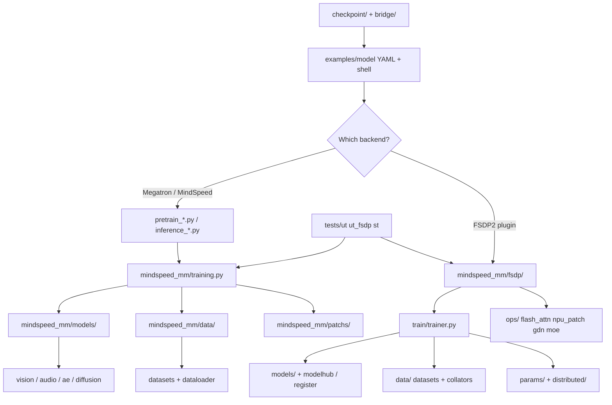

# MindSpeed-MM map

MindSpeed-MM trains and runs multimodal models on Ascend NPUs. A change either
extends a training backend (Megatron + MindSpeed, or FSDP2) or adds an example
that wires model, data, and launch config. Confirm the path in the tree before
editing.



## Dual backend

| Backend | Entry | Typical edits |
| --- | --- | --- |
| Megatron + MindSpeed | `pretrain_vlm.py`, `pretrain_sora.py`, `pretrain_omni.py`, `inference_*.py`, `evaluate_*.py` | `mindspeed_mm/models/`, `data/`, `patchs/`, `training.py`, JSON + shell under `examples/` |
| FSDP2 plugin | `pretrain_transformers.py` or FSDP trainer via YAML | `mindspeed_mm/fsdp/models/`, `fsdp/data/`, `fsdp/train/`, `fsdp/ops/`, YAML + `fsdp*_config` under `examples/` |

Open the matching `examples/<model>/` README and config before changing code.
Match that example's stack; do not port a Megatron provider into FSDP2 by
calling the other tree.

Dependencies (not optional for Megatron path): Ascend CANN + `torch_npu`,
sibling **MindSpeed** (`mindspeed.megatron_adaptor`), and vendored / copied
**Megatron-Core** `megatron/` as in `docs/en/pytorch/install_guide.md`. Pure
FSDP2 UTs live in `tests/ut_fsdp/` and do not need Megatron.

## Request path

### Megatron / MindSpeed

1. Example shell exports Ascend env, sets TP/PP/CP/…, and launches a root
   `pretrain_*.py` / `inference_*.py` with JSON or CLI args.
2. `mindspeed.megatron_adaptor` patches Megatron; `mindspeed_mm/training.py`
   owns the loop.
3. Model and data providers build `mindspeed_mm/models/` and
   `mindspeed_mm/data/` graphs (VLM, Sora/DiT, omni, audio).
4. `mindspeed_mm/patchs/` swaps attention, CP, hetero PP, FSDP2 bridges, and
   similar hooks. A patch that only tests import is missing in real launch.
5. Checkpoints convert through `checkpoint/` (offline) or `bridge/` (online).

### FSDP2

1. Example YAML names `model.model_id`, dataset type, parallel plan, and
   training plugin list; shell runs `torchrun` + entry script.
2. Registration loads plugins; `ModelHub` / model package builds the module.
3. `ParallelApplier` applies TP / EP / CP / FSDP plans from
   `fsdp/params/` and `fsdp/distributed/`.
4. Dataset + collator emit batch keys the model `forward` expects
   (`labels` → `.loss` on the train path).
5. `fsdp/ops/` and `npu_patch` supply Ascend attention and fused ops the
   metadata must match.

## Where to edit

| Change | Look here |
| --- | --- |
| Launch, hyperparams, model README | `examples/<model>/` |
| Shared Megatron training loop | `mindspeed_mm/training.py`, root `pretrain_*.py` |
| VLM / Sora / omni / audio modules (Megatron era) | `mindspeed_mm/models/` (`vision/`, `ae/`, `diffusion/`, `predictor/`, `audio/`, …) |
| Megatron datasets and loaders | `mindspeed_mm/data/` |
| Megatron / CP / attention patches | `mindspeed_mm/patchs/` |
| FSDP2 trainer and engine | `mindspeed_mm/fsdp/train/` |
| FSDP2 model plugins and hub | `mindspeed_mm/fsdp/models/`, registration helpers under `fsdp/` |
| FSDP2 datasets, templates, collators | `mindspeed_mm/fsdp/data/` |
| Parallel args and CP collectives | `mindspeed_mm/fsdp/params/`, `fsdp/distributed/context_parallel/` |
| Flash attn, MoE, Ascend fused ops | `mindspeed_mm/fsdp/ops/` |
| Args and config parsing | `mindspeed_mm/arguments.py`, `configs/`, `fsdp/config/`, `fsdp/params/` |
| Eval / RL / infer tasks | `mindspeed_mm/tasks/`, `fsdp/tasks/`, `fsdp/evaluation/`, `fsdp/inference/` |
| Offline / online weight convert | `checkpoint/`, `bridge/`, CLI `mm-convert` |
| Profiling / memory tools | `mindspeed_mm/tools/`, `fsdp/tools/`, `docs/en/tools.md` |
| Megatron-dependent UTs | `tests/ut/` |
| FSDP UTs (no Megatron) | `tests/ut_fsdp/` |
| System / perf tests | `tests/st/`, `ci/run_ci.sh` |
| English docs | `docs/en/`, `README_en.md`, `CONTRIBUTING_en.md` |

## How components share state

- **Backend choice is a contract.** Providers, YAML keys, and patches are not
  interchangeable across Megatron and FSDP2.
- **Registration vs implementation.** A model or dataset that nothing registers
  never runs. `model_id` / `dataset_type` / plugin imports must agree.
- **Batch keys are part of the kernel contract.** Collator output, processor
  fields (`pixel_values`, `image_grid_thw`, audio features), and `forward`
  kwargs must stay aligned; renaming one side breaks loss.
- **Parallelism duplicates facts.** Global vs local sequence length, expert vs
  EP rank ownership, FSDP shard vs full param view. Name the view the consumer
  reads.
- **Buffers are often shared.** In-place NPU writes and `copy_` update every
  holder. Restoring the caller means swapping the reference back when required.
- **Recompute, offload, and CP** reshape activation lifetimes. A value correct
  on the eager single-rank path can be wrong with recompute or Ulysses/Ring CP.
- **Examples own the golden launch.** Prefer copying the nearest
  `examples/<model>/` pattern over inventing a new flag surface.

## Tests (quick)

```bash
python -m pip install -e '.[test]'
bash ci/run_ci.sh --type=ut --skip_build=1
# or: pytest -x tests/ut ; pytest -x tests/ut_fsdp
```

Needs NPU + `torch_npu` (and Triton-Ascend for many ops UTs). Megatron is
required for `tests/ut` only.
