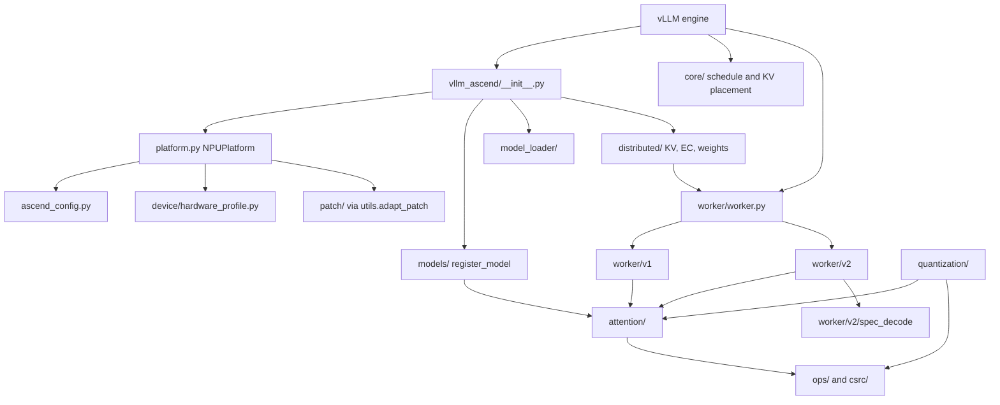

# vLLM-Ascend map

vLLM calls this plugin. A change either registers an Ascend backend or patches an upstream function. Confirm the path in the tree before editing.

## Request path

1. `platform.py` picks the device, attention backend, block size, and graph mode from `ascend_config.py` and `device/hardware_profile.py`.
2. `patch/` replaces upstream functions. Global patches also run from `_ensure_global_patch`, because engine-core subprocesses do not load test conftest.
3. `core/` schedules and places KV.
4. `worker/v1` or `worker/v2` builds inputs and metadata, then runs the model. They do not share a runner. Port a behavior by fitting the runner you are in, not by calling the other one.
5. `attention/` describes the kernel launch. `ops/` and `csrc/` are what that metadata must match.
6. `models/` is only for architectures stock vLLM does not run as-is.
7. `distributed/` moves KV, expert weights, or parameters across ranks. Rank-local metadata must not be given global sizes.
8. `quantization/` changes scales, layouts, and dtypes that kernels and cache code both read.

## Where to edit

| Change | Look here |
| --- | --- |
| What the plugin registers | `vllm_ascend/__init__.py` |
| Device, backend, graph, block size | `platform.py`, `device/` |
| Extra user config | `ascend_config.py`, `envs.py` |
| Scheduling, KV placement | `core/` |
| V1 runner and V1-only paths | `worker/v1/` |
| V2 runner, batch, graphs | `worker/v2/` |
| Draft models and spec decode | `worker/v2/spec_decode/`, `worker/v1/spec_decode/` |
| Attention metadata and context parallel | `attention/` |
| Replace an upstream function | `patch/platform/`, `patch/worker/` |
| Triton, fused MoE, small ops | `ops/` |
| CANN / AscendC kernels | `csrc/` |
| Architecture-specific models | `models/` |
| KV transfer, pools, weight send | `distributed/` |
| Quant and compressed KV | `quantization/` |
| Sampling | `sample/`, `worker/v2/sample/` |
| 310P-only | `_310p/`, `worker/v1/_310p/` |
| Metrics | `observability/` |
| CPU contract tests | `tests/ut/` |
| Device tests | `tests/e2e/` |
| Docs, release notes | `docs/source/`, `release_notes/fragments/` |

## How components share state

- Registration (`__init__.py`) and patching (`patch/`) are different. A new backend that nothing registers never runs. A patch that only tests apply is missing in engine-core.
- Metadata is a description of a kernel. If the kernel reads a field, that field is part of the contract even when the Python looks done.
- Buffers are often shared, not copied. Writing back through `copy_` changes every holder. Restoring the caller's object means swapping the reference back, not writing the old values into the shared storage.
- The same fact usually exists more than once: device tensor, CPU copy, Python list, upper bound, index. Name the one the consumer reads.
- Graph capture freezes shapes and pointers. A value that is right on the eager path can be stale on replay.
- V1 and V2, prefill and decode, and single-rank and context-parallel paths each have their own metadata builder. A fix in one does not cover the others.
